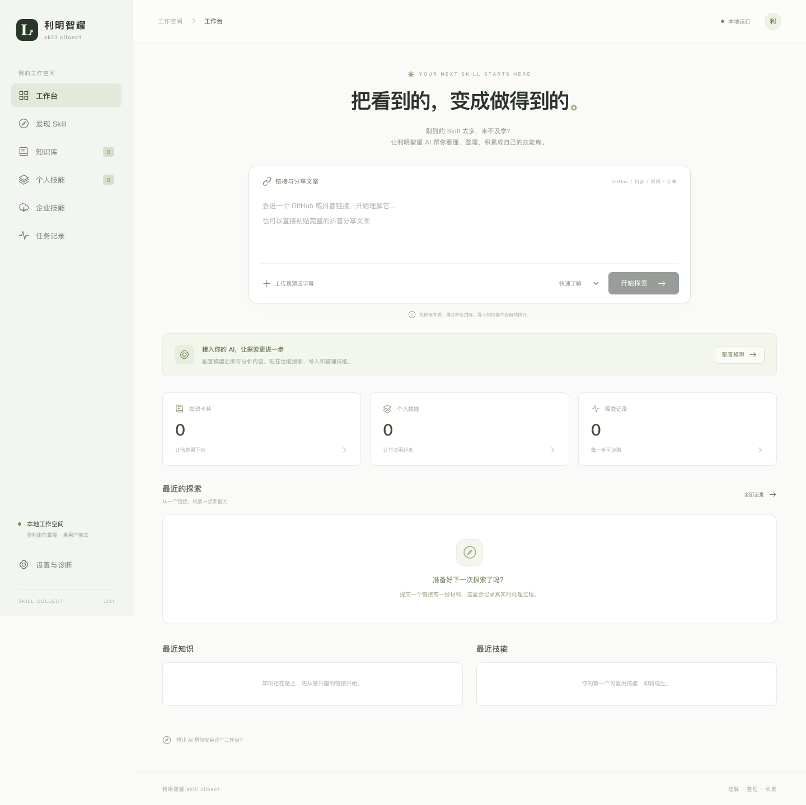
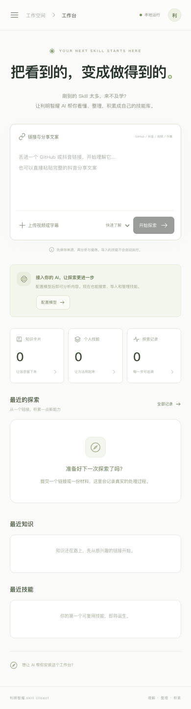

# 利明智耀.skill clloect

刷到的 Skill 太多，来不及学？让利明智耀 AI 帮你看懂、整理，积累成自己的技能库。

一个本地运行的单用户工作台：丢进 GitHub 或抖音链接，或上传视频、字幕，保留来源证据，整理知识和技能，并与已授权的飞书多维表格手动双向同步。展示名保留 `clloect`，技术名为 `liming-zhiyao-skill-collect`。

当前源码 **v0.2.0**：在工作台粘贴抖音分享文字后，项目自动获取原片、分段转写、分析抽样画面并保存知识，不依赖 Codex、已有浏览器登录或人工下载。指定真实分享链接已一次提交完成 **144.8秒原片 → 2段转写 → 8张画面 → 内容分析与知识保存**，约68秒，无补传和手动重试。GitHub 项目关联会核对来源引文，再核验明确仓库地址或检索名称候选；本次转写与8张抽样画面未识别明确项目线索，未强行关联。388项本机测试和生产构建通过，新增三平台CI与独立发行正在核验；历史[v0.1.3](https://github.com/baizhanwen/liming-zhiyao-skill-collect/releases/tag/v0.1.3)保持。详见[验收报告](docs/验收报告.md)与[真实原片脱敏证据](artifacts/verification/douyin-live-e2e-20261029.json)。

## 让 AI 帮你安装

把本仓库地址和下面这段话交给你的 AI 编程助手：

> 请将这个仓库安装到一个新的本地目录。先阅读 AGENTS.md 和 README，检查 Python3.11+、Node.js 和可选 FFmpeg，使用当前平台的 setup 与 start 脚本，不覆盖已有资料。完成后运行诊断和测试，打开本机工作台。模型与飞书授权由我在本地设置中填写，不要在聊天中索取或输出密钥，不自动执行或全局安装导入的第三方技能。

## 安装与启动

需要 Python3.11+、Node.js20.19+/22.12+（推荐 Python3.12、Node24）；uv可选。抖音原片和上传视频分析需要 FFmpeg/FFprobe，其他功能可不安装。setup 会安装锁定的官方 Chromium 采集运行时；客户正常使用只需打开浏览器工作台，无需安装 Codex。系统依赖安装说明见[安装与数据](docs/安装与数据.md)。

macOS / Linux：

```sh
git clone https://github.com/baizhanwen/liming-zhiyao-skill-collect.git
cd liming-zhiyao-skill-collect
bash scripts/setup.sh
bash scripts/start.sh
```

Windows PowerShell7：

```powershell
git clone https://github.com/baizhanwen/liming-zhiyao-skill-collect.git
Set-Location liming-zhiyao-skill-collect
pwsh -File scripts/setup.ps1
pwsh -File scripts/start.ps1
```

打开 **http://127.0.0.1:8765**，不需要任何密钥即可启动、管理知识和完整技能包。后台在同一个本地入口提供构建后的界面；按 Ctrl+C 停止。没有模型时来源分析停在“待配置”，不会生成假的分析成功结果。



<details>
<summary>查看窄屏界面</summary>



</details>

## 可以做什么

| 能力 | 行为和边界 |
|---|---|
| 自配模型 | 分开设置文字、视觉和转写的 Base URL/API Key/模型；独立探测、手填或读取模型列表，返回认证/配额/模型/路径/超时错误 |
| GitHub 来源 | 支持仓库/目录/文件，固定提交、保存真实快照与文件证据；不执行仓库脚本 |
| 发现 Skill | 真实仓库搜索，有 Token 可增加代码搜索；扫描同仓多份 SKILL.md，导入前看正文、文件和许可 |
| 视频/字幕 | 最多100MB/20分钟；120秒音频分段，4或8张关键帧；有字幕时避免重复转写，单独标识字幕、音频及抽帧依据 |
| 抖音链接 | 粘贴分享文字后自动获取公开原片；静态来源不可用时自动启动项目内临时 Chromium，校验视频身份、完整媒体、哈希和音视频轨道，再转写与抽样分析。无需 Codex 或人工下载；访问受限明确失败，补传仅为备用 |
| 视频中的 GitHub 项目 | 从实际转写及画面引文识别项目；明确地址核验仓库，名称自动搜索候选并保留证据、时间、歧义或失败。可独立重查 GitHub；候选不等于已确认同一项目，不执行第三方代码 |
| 个人积累 | 知识与技能分开管理，中文关键词/FTS5、标签/分类、编辑/归档、版本与哈希、实际验证记录、完整ZIP包进出 |
| 飞书互通 | 官方Token/分页记录/字段映射/附件上传下载，预览新增更新、保留同步基线、识别表内直接改动与双边冲突、超时后查询去重；手动执行，不自动传播删除 |
| 任务与数据 | SQLite检查点、有限退避、软取消、重启恢复；未确认结果的模型请求需手动继续；独立加密凭证、备份与新目录恢复 |

使用国内 MiniMax 服务可先阅读[MiniMax 接入说明](docs/MiniMax接入.md)：文字、图片与转写独立配置。当前用户已明确选择MiniMax作为本机文字服务，应用分发仍不附带配置或密钥。精确官方主机与`MiniMax-M3.1-Flash`默认使用`reasoning_effort=low`，高级设置可选五档；不自动增加输出预算。原生ASR及视觉已有独立实测，本次账户可用不代表其他账户或套餐具备同样权益。

## 首次使用

1. 在“设置与诊断”填写文字模型。Base URL 填到 `/v1` 等根路径，不填 `/chat/completions`；不支持 JSON mode 的服务可以关闭该项，输出仍做结构校验。探测会发起真实请求，费用遵循自己的供应商。
2. 粘贴 GitHub 链接或上传 UTF-8 SRT/VTT。查看任务阶段、来源文件、固定版本与证据后，保存知识或生成技能草稿。追问仅使用已保存材料。
3. 在“发现 Skill”搜索，进入仓库逐个选择完整技能包。导入与生成的技能都不会自动获得“已验证”。实际验证由用户提供证据记录，不自动执行第三方脚本。
4. 视频首次使用时分别配置转写和视觉模型，安装 FFmpeg/FFprobe；之后粘贴抖音链接点击“开始探索”即可自动进行原片分析。流程及访问受限边界见[抖音原片获取与分析](docs/抖音原片获取与分析.md)。仅基于字幕的结果不会称作看过画面。
5. 飞书按[接入说明](docs/飞书接入.md)配置企业自建应用、目标表与字段。先验证读取、字段兼容和明确标记的写测试，再预览和手动同步。企业可读范围不等于可发给外部模型的范围。

GitHub匿名API受共享IP限流；仓库快照可自动降级为受限公开Git（需要本机Git），搜索与技能发现有需要时仍须在本地设置Token。应用不会自动读取其他应用的GitHub登录。发布时使用的账户登录与应用运行时Token相互独立。详细说明见[GitHub接入](docs/GitHub接入.md)。

## 架构与数据

```text
React / TypeScript / Vite
          │ 同源本机API
FastAPI ─ SQLite实体/FTS5 ─ 本地文件/ZIP
          │ 单任务工作线程 + 持久化检查点
          ├ 自配兼容模型（文字/视觉/转写分开）
          ├ GitHub REST / 受限匿名公开Git（只读获取，不执行）
          ├ 项目临时 Chromium / 公共来源安全校验 / 本地 FFmpeg
          └ 飞书 REST（手动同步 + 完整包附件）
```

默认 `data/` 保存 SQLite、上传与处理材料；`.secrets.key` 和 `secrets.enc` 将密钥与数据库分离。前端只收到配置状态。普通备份、技能导出与Git均排除凭证，迁移后须重新配置。运行日志位于 `data/logs/server.log`。

来源获取对协议、公共IP、重定向、连接目标及大小进行限制；FFmpeg禁用网络协议和播放列表解复用。模型地址由用户主动配置，本机模型可以用loopback HTTP，远程地址要求HTTPS。默认服务只监听loopback，拒绝跨站请求。本版本没有多人身份隔离，不能直接公开部署成企业SaaS。

## 验证与证据

```sh
uv sync --frozen
uv run --frozen pytest -q
cd frontend
npm ci
npm run build
```

或使用安装后的 `.venv/bin/python -m pytest -q`。无uv安装流程仅安装运行依赖，开发测试需使用锁定开发环境。Windows使用 `.venv\Scripts\python.exe`。

[验收报告](docs/验收报告.md)逐项记录 A01—A13，区分本地业务闭环、显式模拟契约、真实外部调用和发布状态。[实施进度](docs/实施进度.md)、[技术决策](docs/技术决策.md)记录施工选择。`artifacts/verification/`只包含可公开的脱敏结果与界面截图。

## 备份、恢复与升级

```sh
.venv/bin/python scripts/doctor.py --json
.venv/bin/python scripts/backup.py backup --output backups/private-backup.zip
.venv/bin/python scripts/backup.py restore backups/private-backup.zip --target /absolute/new-data
SKILL_COLLECT_DATA=/absolute/new-data bash scripts/start.sh
```

备份包含私人知识/媒体/企业技能，不可发布。只恢复到新空目录；恢复后模型/飞书凭证重新填写，排队任务不会自动外发。升级前停服务并备份，更新源码后重跑setup；详细限制见[安装与数据](docs/安装与数据.md)。

## 已知限制

- 不附赠模型或第三方解析密钥。真实文字、上传视频及飞书联通均依赖用户本地配置；独立实测只覆盖本次供应商、模型、素材及授权目标，其他账户仍需自行测试。契约测试不等于真实服务联通。
- 真实上传视频实测为15.3秒自制片段、4张抽样画面，不能推断为所有视频的准确率。ASR把品牌“利明智耀”识别为“利明制药”，2字同音错误保留，其他规范化文本匹配；品牌和专有名词需要人工复核。
- 0.2.0真实自动获取仅覆盖本机、当前网络和指定144.8秒分享链接，不能保证任意抖音视频可取得。登录、验证码、私密、删除或平台访问限制不会绕过，也不购买解析服务。受限任务保留；补传是明确的备用路径。
- 旧原任务的网页AI章节摘要纯文本续接、旧静态获取失败和0.2.0原片新任务分别保留；浏览器能播放、标题可读或平台摘要不等于已取得和分析媒体。
- 仅当系统DNS全部返回FakeIP时，采集器使用固定HTTPS公共DNS校验结果并连接已验证公网IP；私网、回环、混合私网结果及字面FakeIP仍拒绝。其他网络限制可能导致失败，不改变用户系统代理配置。
- 本次原片没有明确项目标识，因此“真实视频提及 → 实时GitHub匹配”的阳性场景未验证；识别、候选、歧义、无匹配及限流已有显式契约测试。GitHub匿名搜索受共享IP限流，可在本地设置Token；应用不借用其他程序的登录。
- 关键帧最多8张，并非逐帧观看整个视频；转写时间为120秒段范围，不编造词级时间戳。字幕时间保留原文件；TXT不编造时间证据。
- 模型输出是辅助分析。来源自述、代码观察、推断和用户实际验证分开；不保证外部仓库内容、许可证和模型输出本身正确。
- 同步是有摘要复查的乐观并发，飞书记录接口没有已核实的原子CAS；多人同时写入的最终窗口不能保证强一致。上次创建结果不明时保守停止，不盲目创建副本；未绑定素材不自动删除。
- 取消停止后续阶段；已发出的请求可能运行到超时并产生供应商费用。进程在外部请求中断时不能保证供应商恰好调用一次，恢复会要求人工继续。
- 本地检索以FTS5与中文子串为基线；未启用embedding语义检索。没有自动定时同步、企业统一登录或移动端原生应用。
- v0.1.2的Ubuntu/macOS/Windows核心测试、安装、构建与诊断均在CI通过。CI缺FFmpeg/FFprobe，媒体项未验证；本机macOS媒体测试通过。Windows另跳过需开发者权限的符号链接创建测试及仅适用于POSIX的TIME_WAIT地址复用测试。

MIT 许可。第三方条款与来源见[THIRD_PARTY_NOTICES.md](THIRD_PARTY_NOTICES.md)。
